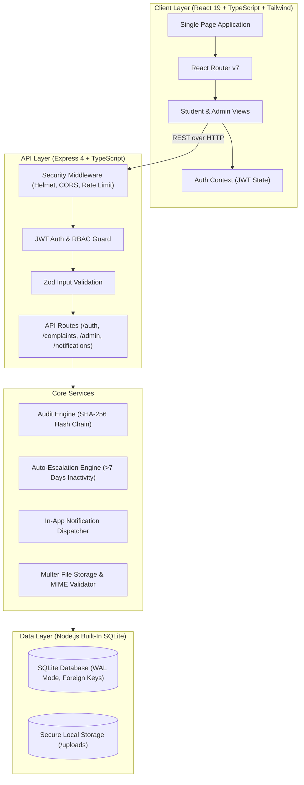
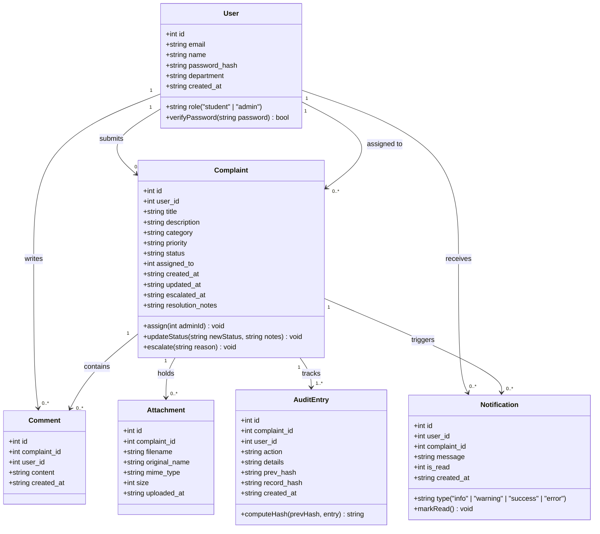
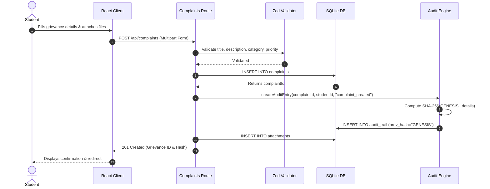
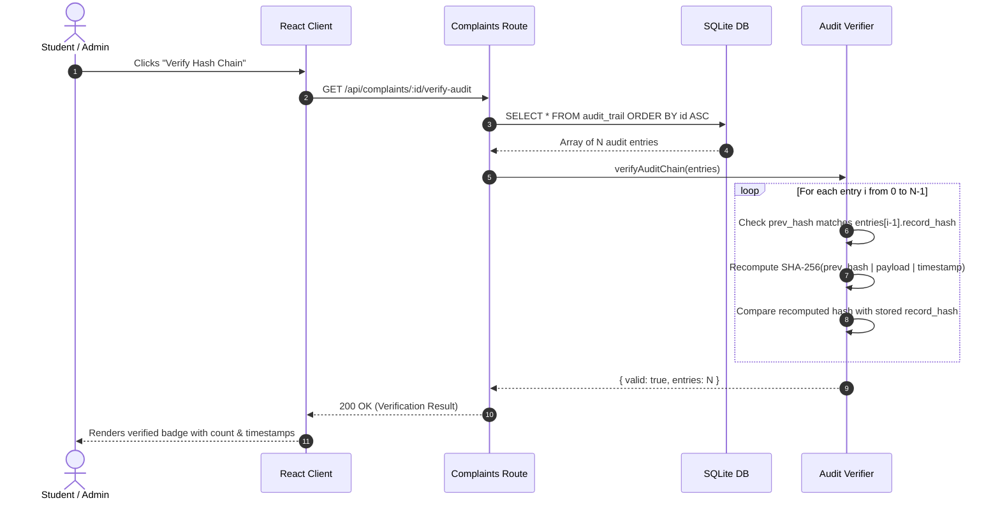

# NyayaSetu System Architecture & Technical Specifications

> **E3 Code Sangam 2026 Hackathon**  
> **Team:** Web_Shooter  
> **Project:** NyayaSetu — Transparent Grievance Redressal Portal

---

## 1. System Overview

NyayaSetu is a secure, role-based college grievance redressal portal. It bridges institutional trust between students and university administration through full transparency, real-time tracking, proactive escalation, and a cryptographic SHA-256 hash chain audit log.

---

## 2. Class & Domain Model Diagram

---

## 3. Workflows & Sequence Diagrams

### 3.1 Grievance Submission & Audit Genesis

### 3.2 Audit Hash Chain Verification

---

## 4. Advanced Security Features

### 4.1 Cryptographic Hash Chain Audit Trail
Every state transition on a grievance (`complaint_created`, `status_change`, `officer_assigned`, `comment_added`, `auto_escalated`) appends a cryptographic hash record:
$$\text{record\_hash} = \text{SHA-256}(\text{prev\_hash} \parallel \text{complaint\_id} \parallel \text{user\_id} \parallel \text{action} \parallel \text{details} \parallel \text{timestamp})$$

#### Security Boundaries & Limitations
> [!IMPORTANT]
> **What the Hash Chain Guarantees:**
> - Detects any post-facto modification of existing logs by unauthorized parties or application bugs.
> - Detects deletion or omission of intermediate history entries.
> - Preserves deterministic verification for student transparency.
>
> **Documented Limitations:**
> - An adversary possessing direct root filesystem write access to the underlying SQLite file could theoretically recompute downstream hashes.
> - It provides **tamper-evidence**, not tamper-resistance without external anchoring (e.g., publishing periodic Merkle roots to an external public blockchain or RFC 3161 timestamping authority).

### 4.2 Auto-Escalation Engine
- **Trigger**: Automated background scan via `POST /api/admin/check-escalations` or scheduled cron.
- **Rule**: Any complaint remaining in `open` or `in_progress` status without updates for $\ge 7$ days (`ESCALATION_DAYS` env var) is automatically transitioned to `escalated`.
- **Side Effects**:
  1. Status updated to `escalated`, setting `escalated_at`.
  2. Urgent notification dispatched to the student.
  3. Escalation notification dispatched to all university administrators.
  4. Immutable entry appended to the cryptographic audit trail.

### 4.3 Privacy-Preserving Analytics
- **PII Stripping**: The analytics endpoint (`/api/admin/analytics`) strictly computes mathematical aggregations (`COUNT(*)`, `AVG(julianday) * 24`, `strftime('%Y-%m')`).
- **Student Anonymity**: Student names, roll numbers, departments, emails, and textual descriptions are never queried or transmitted in analytics payloads.

---

## 5. Technology Stack Decisions

| Component | Selected Technology | Rationale |
|---|---|---|
| **Frontend** | React 19 + TypeScript | High performance, strict typing, reactive UI |
| **Bundler** | Vite 6 | Sub-second HMR and optimized production bundling |
| **Styling** | Tailwind CSS 3 | Maintainable utility CSS with institutional color themes |
| **Backend** | Express 4 + TypeScript | Lightweight, standards-compliant REST architecture |
| **Database** | Node.js Built-In SQLite (`node:sqlite`) | Zero-install, portable, synchronous, SQL-standard |
| **Security** | Helmet, bcryptjs, JWT | 12-round salted hashing, stateless JWT authorization |
| **Validation** | Zod | Runtime schema validation with typed error reporting |
| **Testing** | Vitest + Testing Library + Supertest | Rapid unit, component, and full integration API tests |
